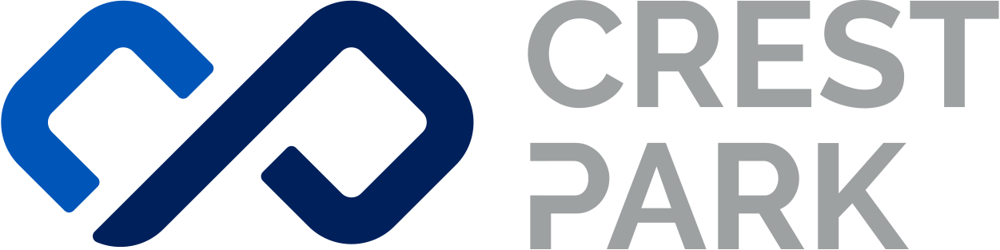

  

<h3 align="center">Long-term partners to good businesses ready to accelerate.</h3>

Crest Park partners with and advises founder-led businesses as they sharpen strategy and modernize
operations and technology.

### What we build

AI changes the most in industries that technology has passed over. We bring a library of AI agents built
inside real businesses, tested in our own company first, and fitted to each partner. Our agents:

- **work where the team already works**, in chat and email, not in one more tool to log in to
- **know the business**: its plans, its calls, its systems, and who is allowed to see what
- **do real work**: keep a project plan current, draft the follow-up, redline the contract, update the CRM
- **ask before they act**: anything that reaches a customer or changes a record waits for a person's tap

### How we work

- We run every agent on our own operations before a client sees it.
- Each client's agent and data live apart from every other client's.
- Clients own their systems. If we part ways, they keep everything.

### Get in touch

[crestpark.co](https://crestpark.co)

Our repositories are private. This page is the public face of the organization.
